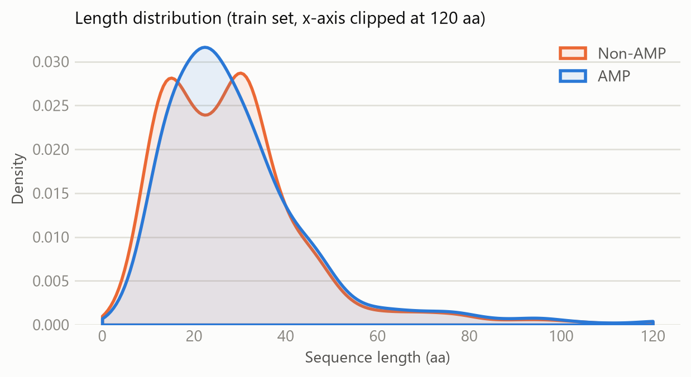
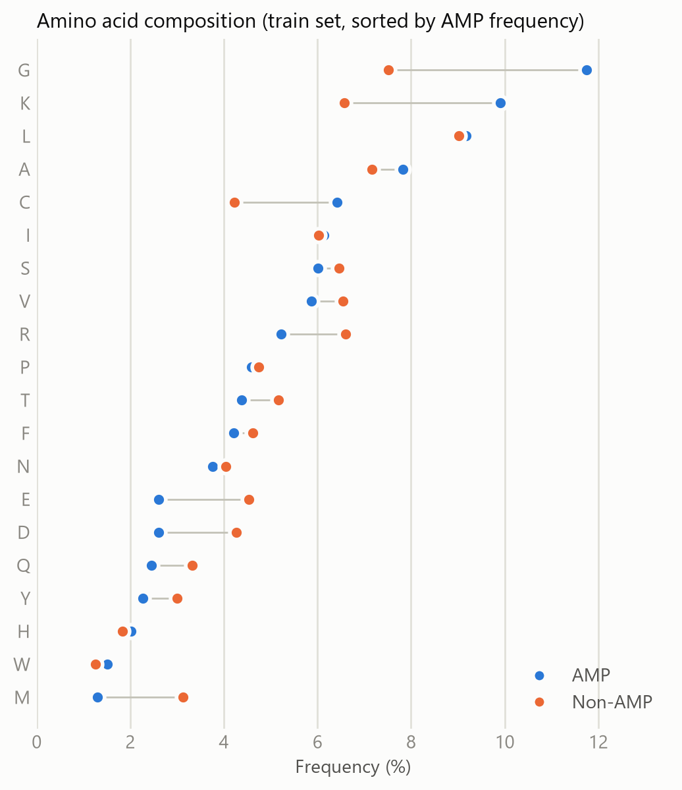
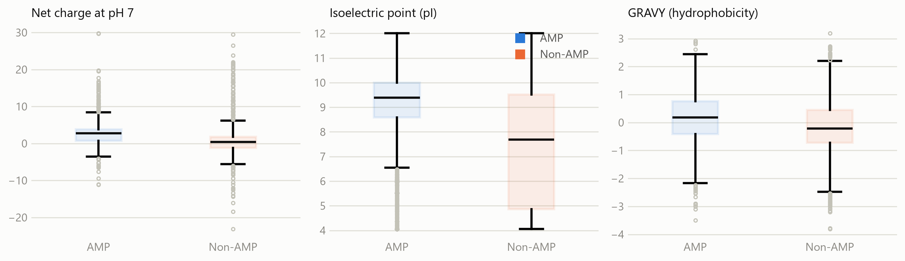
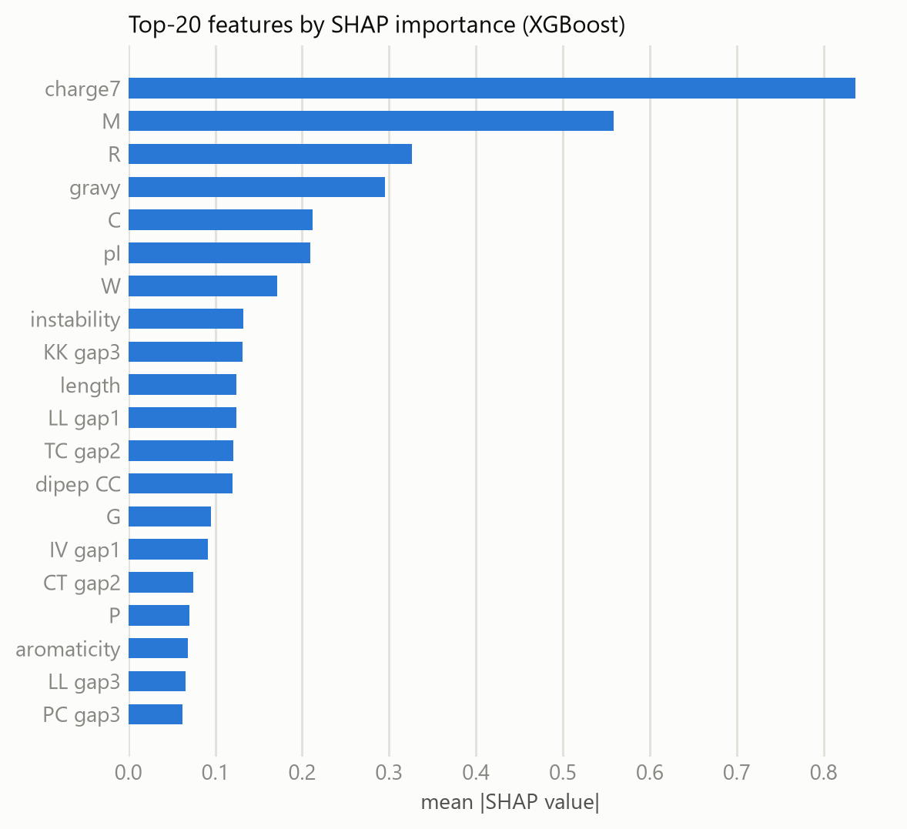
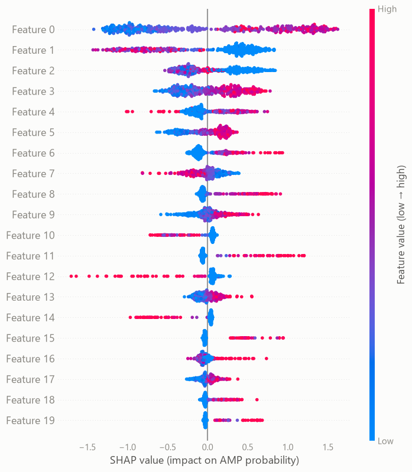
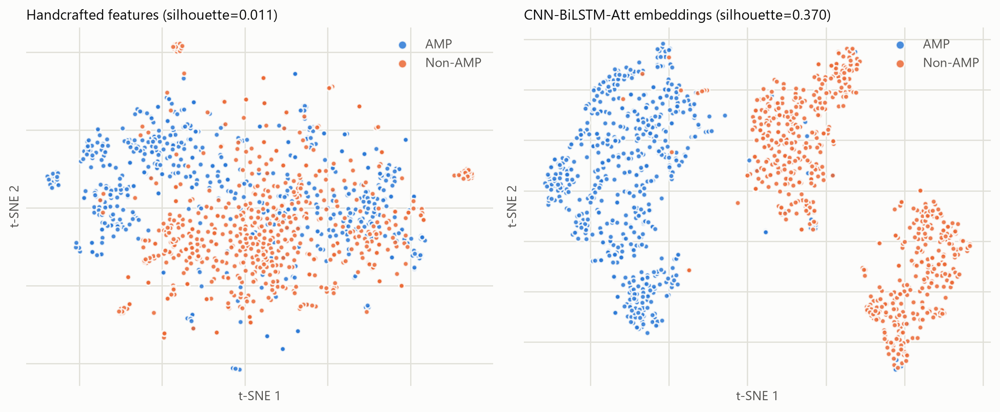
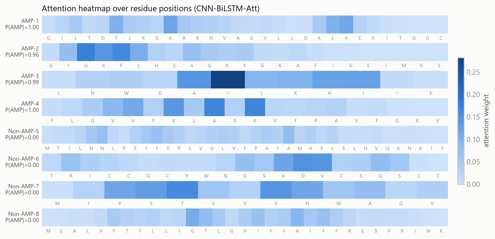
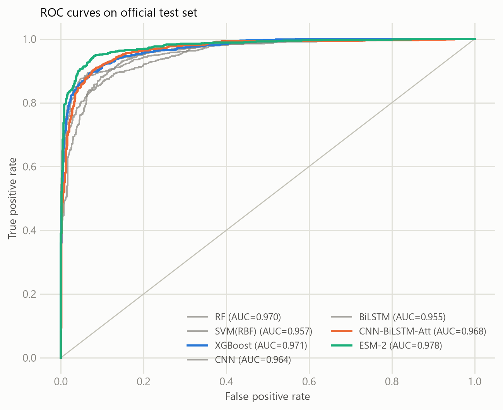

# 基于多策略深度学习的抗菌肽识别研究

## 摘要

抗菌肽是生物体天然免疫系统的重要组成部分，被视为应对全球抗生素耐药性危机最有前景的替代药物之一。传统实验筛选成本高昂，基于计算的抗菌肽识别已成为生物信息学领域的重要研究方向。本文围绕抗菌肽识别的三代计算方法展开系统研究：第一代方法以手工设计的序列特征（氨基酸组成、二肽组成、k 间隔残基对组成与理化性质，共 1626 维）结合随机森林、支持向量机与 XGBoost 等传统机器学习模型；第二代方法采用多尺度卷积神经网络、双向长短期记忆网络及其与注意力机制结合的混合模型，直接从序列学习判别表示；第三代方法在预训练蛋白语言模型 ESM-2（35M 参数）上进行微调，迁移其从约 6500 万条蛋白序列中学习到的进化信息。全部实验在公开的 AMPlify 平衡数据集（训练集 3338 条抗菌肽与 3338 条非抗菌肽，测试集 835 条与 835 条）上，以统一的评估协议（固定随机种子、五折分层交叉验证、独立测试集）进行。结果表明：XGBoost 与混合深度模型在分布内测试上性能相当（AUC 分别为 97.07% 与 96.78%），微调后的 ESM-2 取得最佳单模型成绩（准确率 92.75%、AUC 97.83%），三代模型概率集成进一步将成绩提升至准确率 93.35%、AUC 98.27%。SHAP 分析揭示净电荷是模型的首要判别依据，与抗菌肽的阳离子膜破坏机制高度吻合；注意力热图与 t-SNE 可视化进一步佐证了模型学到判别性表示的机制。在非平衡筛选场景（正负比约 1:31）与 8 个独立外部数据库的泛化评估中，模型泛化能力随代际严格递增，ESM-2 在全部 8 个外部库上胜出。此外，本文以牛蛙蛋白组扫描作为应用案例检验了系统的候选发现能力，并揭示了信号肽假阳性这一真实发现管线中的关键问题。本文还提供了交互式预测演示，并将全部代码开源发布。

**关键词**：抗菌肽；序列分类；特征工程；深度学习；蛋白语言模型；可解释性

## Abstract

Antimicrobial peptides (AMPs), as key components of the innate immune system, are regarded as one of the most promising alternatives to conventional antibiotics in the face of the global antimicrobial resistance crisis. Since experimental screening is costly, computational identification of AMPs has become an important research direction in bioinformatics. This thesis systematically investigates three generations of computational methods for AMP identification. The first generation combines handcrafted sequence features (amino acid composition, dipeptide composition, composition of k-spaced amino acid pairs, and physicochemical properties, 1626 dimensions in total) with traditional machine learning models including random forest, support vector machine, and XGBoost. The second generation learns discriminative representations directly from sequences using a multi-scale convolutional neural network, a bidirectional long short-term memory network, and a hybrid model combining both with an attention mechanism. The third generation fine-tunes the pretrained protein language model ESM-2 (35M parameters), which transfers evolutionary information learned from approximately 65 million protein sequences. All experiments are conducted on the public AMPlify balanced dataset (3,338 AMPs and 3,338 non-AMPs for training; 835 and 835 for testing) under a unified evaluation protocol with fixed random seeds, stratified five-fold cross-validation, and an independent test set. Results show that XGBoost and the hybrid deep model achieve comparable in-distribution performance (AUC of 97.07% versus 96.78%), while fine-tuned ESM-2 attains the best single-model result (accuracy 92.75%, AUC 97.83%), and a probability ensemble of the three generations further improves performance to 93.35% accuracy and 98.27% AUC. SHAP analysis reveals that net charge is the dominant discriminative feature, consistent with the cationic membrane-disruption mechanism of AMPs; attention heatmaps and t-SNE visualization further corroborate the mechanism by which the models learn discriminative representations. In generalization evaluations on an imbalanced screening scenario (positive-to-negative ratio about 1:31) and eight independent external databases, generalization ability improves strictly across generations, with ESM-2 winning on all eight external databases. Furthermore, a bullfrog proteome scan is presented as an application case, which validates the candidate discovery capability of the system and reveals the signal-peptide false-positive issue in real discovery pipelines. An interactive prediction demo is provided and the full code is released as open source.

**Key words**: antimicrobial peptide; sequence classification; feature engineering; deep learning; protein language model; interpretability

## 目录

（自动生成）

# 第1章 绪论

## 1.1 抗菌肽的生物学背景

抗菌肽是一类由生物体基因编码的短肽，长度通常为 10 至 50 个氨基酸残基，广泛存在于从细菌到人类的各类生物体中，是先天免疫系统的第一道防线。与靶向特定蛋白靶点的传统抗生素不同，多数抗菌肽通过物理机制发挥广谱抗菌活性：其分子携带净正电荷（阳离子性），能够与表面带负电的细菌细胞膜磷脂发生静电吸附；同时其氨基酸残基在空间上呈两亲性排布（疏水残基与亲水残基分区聚集），从而插入并破坏细菌细胞膜，导致内容物泄漏与菌体死亡。由于这种非特异性物理杀伤机制不依赖单一靶点，细菌难以通过点突变产生耐药性，抗菌肽因此被视为应对全球抗生素耐药性危机最有前景的候选药物之一。

自 1980 年代以来，研究者已从两栖类、昆虫、哺乳动物等物种中发现数千种天然抗菌肽，并建立了 APD、DRAMP、dbAMP、CAMP 等多个专门的抗菌肽数据库。其中 APD3（Antimicrobial Peptide Database）收录了约三千条经过实验验证的抗菌肽序列，是领域内引用最广泛的权威数据源；DRAMP 与 dbAMP 等数据库则进一步整合了活性数据与结构信息，为计算研究提供了规模可观的训练素材。然而，自然界中尚未被发现的候选抗菌肽数量远高于已收录规模——从数以亿计的天然序列中逐一进行湿实验筛选的成本极高。以计算方法预测"一段肽序列是否具有抗菌活性"，从而在实验验证之前大幅缩小候选空间，已成为加速抗菌肽发现的关键环节，也是生物信息学与人工智能交叉领域的热点问题。

## 1.2 计算识别方法的发展脉络

抗菌肽计算识别方法经历了三代演进。第一代方法以特征工程加传统机器学习为核心：Xiao 等人于 2013 年提出的 iAMP-2L 使用伪氨基酸组成（PseAAC）编码序列并结合支持向量机，在包含 879 条抗菌肽与 2405 条非抗菌肽的经典基准上建立了分类体系，成为该领域的基准方法。伪氨基酸组成的思想——在氨基酸频率之外补充序列顺序与理化信息——深刻影响了后续特征设计，本文使用的二肽组成与 k 间隔残基对组成正是该思想的延续。第二代方法以端到端深度学习为标志：Yan 等人于 2020 年提出的 Deep-AmPEP30 使用卷积神经网络直接从序列学习表示，在 30 个残基以内的短抗菌肽预测上取得进展；Li 等人于 2022 年提出的 AMPlify 采用双向长短期记忆网络与注意力机制的集成模型，五折交叉验证 AUC 达到 97.44%，并成功从牛蛙基因组中发现多条对 WHO 重点病原体有效的新型抗菌肽。第三代方法受益于预训练语言模型的兴起：Lin 等人于 2023 年发布的 ESM-2 系列蛋白语言模型在约 6500 万条蛋白序列上以掩码语言建模目标预训练，其学习到的表示蕴含丰富的进化与结构信息，通过微调可迁移到蛋白功能预测、结构预测等各类下游任务，在多个基准上刷新纪录。

## 1.3 研究目标与主要工作

尽管上述三代方法各有代表性工作，但领域内缺少在同一数据集、同一评估协议下对三代方法的系统对比，也缺少对模型判别机制与分布外泛化能力的统一考察。本文围绕抗菌肽识别展开如下工作：（1）构建包含 1626 维手工特征的完整特征工程体系，并实现随机森林、支持向量机与 XGBoost 三个传统机器学习基线；（2）实现多尺度卷积神经网络、双向长短期记忆网络与 CNN-BiLSTM-注意力混合模型三类深度学习模型；（3）在预训练蛋白语言模型 ESM-2 上进行下游微调，代表第三代方法；（4）以固定随机种子的五折交叉验证与独立测试集统一评估全部七个模型，并考察三代概率集成的效果；（5）通过 SHAP、注意力热图与 t-SNE 三种可解释性手段验证模型判别依据与生物学机制的一致性；（6）在非平衡筛选场景与八个独立外部数据库上评估跨分布泛化能力；（7）以牛蛙蛋白组扫描作为应用案例检验系统的实际应用价值；（8）开发交互式预测演示并将全部代码开源发布。

# 第2章 材料与方法

## 2.1 数据集

本文采用 AMPlify 公开的平衡数据集。其中抗菌肽（阳性样本）来自 APD3 与 DADP 两个权威抗菌肽数据库，经去冗余处理；非抗菌肽（阴性样本）通过关键词过滤从 UniProtKB/Swiss-Prot 数据库中采样，并保证与训练集无重叠。数据划分沿用官方方案：训练集包含 3338 条抗菌肽与 3338 条非抗菌肽，测试集包含 835 条抗菌肽与 835 条非抗菌肽。此外，本文使用该数据集的非平衡测试集（835 条抗菌肽对 25689 条非抗菌肽，正负比约 1:31）用于模拟真实筛选场景的泛化评估，并使用来自八个独立数据库（APD3、YADAMP、CAMP、dbAMP、LAMP、DBAASP、DRAMP、XU）的测试集进行跨数据库外部验证。数据质量检查确认：全部序列仅含 20 种标准氨基酸，无重复序列。

## 2.2 探索性数据分析

长度分布方面，两组序列的长度分布接近，中位长度约 26 至 27 个残基，绝大部分序列不超过 64 个残基（图 2-1），据此后续深度学习模型将最大输入长度设为 64（仅截断 5.3% 的长序列）。氨基酸组成方面（图 2-2），抗菌肽显著富集 G（1.56 倍）、C（1.52 倍）、K（1.51 倍）、W（1.20 倍）与 H（1.10 倍），贫化 E（0.57 倍）、D（0.61 倍）与 M（0.42 倍）：其中赖氨酸 K 携带正电荷、半胱氨酸 C 可形成二硫键稳定结构、甘氨酸 G 赋予骨架柔性，均为抗菌肽的经典结构特征；谷氨酸 E 与天冬氨酸 D 为酸性残基，会抵消阳离子性；甲硫氨酸 M 易氧化不稳定。理化性质方面（图 2-3），抗菌肽组净电荷（pH 7）均值 +2.79（非抗菌肽组 +0.96）、等电点中位数 9.4（对照 7.7）、疏水性 GRAVY 均值 +0.168（对照 −0.128），三项指标均指向"阳离子加两亲性"的典型抗菌肽特征，与文献报道的膜破坏机制一致。上述分析表明数据集构造合理、生物学信号清晰。

## 2.3 特征工程

本文对每条肽序列计算 1626 维特征，由四组构成。（1）氨基酸组成（AAC，20 维）：20 种标准氨基酸在序列中的出现频率，刻画整体组成偏好。（2）二肽组成（DPC，400 维）：相邻残基对的频率，捕捉局部顺序信息，可视为伪氨基酸组成思想的最简实现。（3）k 间隔残基对组成（CKSAAP，1200 维）：间隔 k=1、2、3 的残基对频率（每种间隔 400 维），用于捕捉非相邻位置之间的长程关联，例如带电残基在序列上的间隔排布模式。（4）理化性质（6 维）：序列长度、pH 7 条件下的净电荷、等电点、疏水性 GRAVY、芳香性与不稳定指数，由 Biopython 的 ProtParam 模块计算。其中电荷与疏水性等性质直接编码了抗菌肽的核心判别机理，为树模型提供了强物理先验。

## 2.4 传统机器学习模型

随机森林（RF）采用 500 棵决策树。支持向量机（SVM）采用 RBF 核，由于 RBF 核对特征尺度敏感，构建了"特征标准化加概率校准"的流水线（CalibratedClassifierCV）。XGBoost 采用 300 轮迭代、学习率 0.1、最大深度 6。三个模型均使用默认阈值 0.5 输出预测。

## 2.5 深度学习模型

序列以残基索引编码（20 种氨基酸加 padding 标记），固定长度 64。构建三个模型：（1）CNN：残基嵌入层加 3 个不同尺度（卷积核 3/5/7）的一维卷积，经掩码全局最大池化（padding 位置不参与池化）后接全连接层；（2）BiLSTM：残基嵌入加两层双向 LSTM（以 pack_padded_sequence 屏蔽 padding），取末层前向与后向隐状态拼接后接全连接层；（3）CNN-BiLSTM-Att：卷积特征提取加双向 LSTM，再以注意力机制对时间步加权池化，融合局部模式与长程依赖。训练统一采用 Adam 优化器（学习率 1e-3，权重衰减 1e-4）、二分类交叉熵损失，训练 20 轮。

## 2.6 预训练蛋白语言模型微调

采用 ESM-2 的 35M 参数版本（esm2_t12_35M_UR50D，约 3350 万参数）。该模型由 12 层 Transformer 编码器构成，以掩码语言建模目标在约 6500 万条 UniRef 蛋白序列上预训练。本文在其编码器之上接入随机初始化的二分类头，进行全参数微调：AdamW 优化器（学习率 2e-5，权重衰减 0.01），训练 4 轮，序列最大长度 64。模型权重经 hf-mirror 镜像下载。

## 2.7 可解释性分析方法

（1）SHAP：对 XGBoost 使用 TreeExplainer 计算各特征的边际贡献（SHAP 值），量化特征重要性及其作用方向。（2）注意力热图：可视化 CNN-BiLSTM-Att 对残基位置注意力的分布，识别模型关注的序列区域。（3）t-SNE 加 silhouette 系数：分别对手工特征空间与深度模型嵌入空间降维可视化，并以 silhouette 系数量化两类样本的可分性。

## 2.8 评估协议

开发阶段采用五折分层交叉验证，全部实验固定随机种子 42，各模型的交叉验证切分完全一致，保证对比公平；评估指标为准确率、AUC、F1 与 MCC（均值加减标准差）。最终评估阶段，各模型在完整训练集上训练后在官方测试集上评估一次，另报告敏感性与特异性。泛化评估包括非平衡压力测试（含基于验证集的阈值优化分析）与八个外部数据库的零样本直接评估。实验环境：Python 3.13、PyTorch 2.11（CUDA 12.8）、NVIDIA RTX 4060 Laptop 8GB；特征计算与理化性质使用 Biopython 1.88。

# 第3章 结果与分析

## 3.1 五折交叉验证

七类模型的五折交叉验证结果如表 3-1 所示。传统机器学习方面，XGBoost 表现最佳（准确率 90.80%、AUC 96.74%），随机森林次之，SVM 在标准化与校准后达到 88.41% 的准确率。深度学习方面，CNN 与 BiLSTM 单独使用均略低于树模型，混合注意力模型达到与 XGBoost 相当的水平（AUC 96.85%）。ESM-2 微调以绝对优势领先：平均准确率 97.90%、AUC 99.44%，部分交叉验证折上达到满分，远超其余模型。参考 AMPlify 原文五折交叉验证报告（准确率 92.79%、AUC 97.44%），本文复现的第一、二代方法处于合理区间。

| 模型 | 准确率(%) | AUC(%) | F1(%) | MCC |
|---|---|---|---|---|
| RF | 90.25 ± 0.61 | 96.44 ± 0.30 | 90.11 ± 0.60 | 0.806 |
| SVM(RBF) | 88.41 ± 0.52 | 95.30 ± 0.38 | 88.07 ± 0.55 | 0.769 |
| XGBoost | 90.80 ± 0.81 | 96.74 ± 0.31 | 90.71 ± 0.82 | 0.816 |
| CNN | 89.90 ± 0.79 | 96.43 ± 0.34 | 90.01 ± 0.79 | 0.798 |
| BiLSTM | 89.99 ± 0.53 | 96.10 ± 0.57 | 90.05 ± 0.59 | 0.800 |
| CNN-BiLSTM-Att | 90.80 ± 0.70 | 96.85 ± 0.29 | 90.70 ± 0.80 | 0.817 |
| ESM-2 微调 | 97.90 ± 2.72 | 99.44 ± 0.99 | 97.88 ± 2.77 | 0.958 |

表 3-1 五折交叉验证结果（均值 ± 标准差）

## 3.2 官方测试集评估

各模型在完整训练集上训练后在官方测试集（835 条对 835 条）上的评估结果如表 3-2 所示。全部模型测试集成绩与交叉验证高度一致（如 XGBoost：交叉验证 90.80/96.74 对测试集 90.90/97.07），未见明显过拟合。测试集上随机森林（AUC 97.01%）与 XGBoost（97.07%）互有胜负，混合深度模型（96.78%）紧随其后；ESM-2 以准确率 92.75%、AUC 97.83% 位居全部单模型之首；将三代代表模型（XGBoost、CNN-BiLSTM-Att、ESM-2）的输出概率取均值集成后，准确率提升至 93.35%、AUC 提升至 98.27%，超过全部单模型，说明三代方法学到的判别信息存在互补性。

| 模型 | 准确率(%) | AUC(%) | F1(%) | MCC | 敏感性(%) | 特异性(%) |
|---|---|---|---|---|---|---|
| RF | 91.14 | 97.01 | 90.91 | 0.824 | 88.62 | 93.65 |
| SVM(RBF) | 88.08 | 95.73 | 87.57 | 0.764 | 83.95 | 92.22 |
| XGBoost | 90.90 | 97.07 | 90.69 | 0.819 | 88.62 | 93.17 |
| CNN | 88.62 | 96.41 | 88.90 | 0.773 | 91.14 | 86.11 |
| BiLSTM | 89.04 | 95.54 | 89.20 | 0.781 | 90.54 | 87.54 |
| CNN-BiLSTM-Att | 90.72 | 96.78 | 90.40 | 0.816 | 87.43 | 94.01 |
| ESM-2 微调 | 92.75 | 97.83 | 92.52 | 0.857 | 89.58 | 95.93 |
| 三代集成(均值) | 93.35 | 98.27 | 93.14 | 0.869 | 90.18 | 96.53 |

表 3-2 官方测试集评估结果

## 3.3 ESM-2 微调结果分析

ESM-2 在五折交叉验证中平均 AUC 达 99.44%（准确率 97.90%），在官方测试集上准确率 92.75%、AUC 97.83%，均为全部单模型最高。值得注意的是，其交叉验证成绩高于独立测试集约 1.6 个 AUC 百分点，存在一定的交叉验证乐观偏差：在小规模数据（6676 条）上微调 35M 参数模型时，逐折训练可能轻微拟合验证折，独立测试集成绩是更可信的估计。尽管如此，ESM-2 在测试集上仍相对第二名（XGBoost）领先 0.76 个 AUC 百分点与 1.85 个准确率百分点，证实了预训练进化信息表示对下游小样本任务的迁移价值。

## 3.4 SHAP 特征重要性

对 XGBoost 计算 SHAP 值（500 条采样），重要性前 20 特征如图 3-1 与图 3-2 所示。净电荷（charge7）以断层优势排名第一（mean|SHAP| = 0.84，第二名仅 0.56），方向为促进抗菌肽分类——模型的第一判别依据正是阳离子性，与抗菌肽的膜破坏机制直接对应。促进抗菌肽的特征包括：精氨酸 R（+0.33）、疏水性 GRAVY（+0.30）、KK 间隔对（+0.13）、CC 二肽（+0.12）以及 TC/CT 间隔模式（半胱氨酸成对出现的二硫键信号）。抑制抗菌肽的特征包括：蛋氨酸 M（−0.56）、半胱氨酸 C（−0.21）、色氨酸 W（−0.17）与脯氨酸 P（−0.07）。值得讨论的是，探索性分析显示 C 在抗菌肽中富集 1.52 倍，但 SHAP 中其边际贡献为负：半胱氨酸往往与电荷、赖氨酸含量等其他抗菌肽特征共现，其单变量富集并不代表边际判别作用——这正是单变量统计与模型可解释性分析的互补之处。

## 3.5 嵌入空间可视化

对 1200 条采样序列做 t-SNE 可视化（图 3-3）：手工特征空间（标准化后直接计算）的 silhouette 系数仅 0.011，两类样本几乎不形成簇；而 CNN-BiLSTM-Att 注意力池化嵌入的 silhouette 系数达 0.370，两类样本明显分离。这表明深度学习模型学到了判别性更强的表示空间，也为深度模型在分布外场景下的更好表现提供了直观解释。

## 3.6 注意力热图

选取 8 条高置信正确预测的示例（4 条抗菌肽与 4 条非抗菌肽）可视化注意力分布（图 3-4）。模型对抗菌肽的注意力峰值权重（0.12 至 0.28）整体高于非抗菌肽（0.08 至 0.16），提示抗菌肽判别依赖更集中的局部模式（如带电残基簇），而非抗菌肽的判别信号相对弥散。

## 3.7 非平衡压力测试

以 835 条抗菌肽对 25689 条非抗菌肽（约 1:31）模拟真实基因组筛选场景，结果如表 3-3 所示。两点结论：其一，类别极不平衡时固定阈值 0.5 会导致精确率崩塌（XGBoost 精确率仅 0.178），必须按应用场景进行阈值优化——以最大化 F1 为目标时，XGBoost 的最优阈值为 0.942，F1 从 0.296 提升至 0.680；其二，泛化能力随代际严格递增，AUC 依次为 94.90%、96.30% 与 98.80%；其三，ESM-2 在默认阈值下的精确率（0.557）远高于前两代（0.178 与 0.311），说明其输出概率校准更好，直接可用性更强。

| 模型 | AUC | PR-AUC | 阈值0.5时 F1/精确率/召回率 | 最优阈值 | 最优 F1/精确率/召回率 |
|---|---|---|---|---|---|
| XGBoost | 0.949 | 0.728 | 0.296 / 0.178 / 0.886 | 0.942 | 0.680 / 0.750 / 0.622 |
| CNN-BiLSTM-Att | 0.963 | 0.604 | 0.459 / 0.311 / 0.874 | 0.994 | 0.624 / 0.582 / 0.672 |
| ESM-2 微调 | 0.988 | 0.858 | 0.687 / 0.557 / 0.896 | 0.957 | 0.777 / 0.779 / 0.775 |

表 3-3 非平衡压力测试结果（正负比约 1:31）

## 3.8 跨数据库外部验证

在 8 个独立数据库的测试集上直接评估（模型未用这些数据做任何训练或调参），结果如表 3-4 所示。规律有二：其一，泛化能力随代际严格递增——深度模型对 XGBoost 胜出 6/8 个库，ESM-2 在全部 8 个库上胜出；其二，训练阳性数据源 APD3 对应的外部库表现最好（ESM-2 AUC 0.985），而规模大、噪声高的 XU 与 DRAMP 掉幅最大，模型性能与数据分布同源性高度相关。

| 数据库 | 规模(AMP/非AMP) | XGBoost 准确率/AUC | CNN-BiLSTM-Att 准确率/AUC | ESM-2 准确率/AUC |
|---|---|---|---|---|
| APD3 | 494/494 | 0.889/0.957 | 0.925/0.967 | 0.945/0.985 |
| YADAMP | 324/324 | 0.886/0.937 | 0.897/0.938 | 0.923/0.976 |
| CAMP | 203/203 | 0.855/0.884 | 0.857/0.904 | 0.872/0.965 |
| dbAMP | 522/522 | 0.857/0.928 | 0.873/0.921 | 0.877/0.964 |
| LAMP | 1054/1054 | 0.749/0.806 | 0.739/0.827 | 0.738/0.881 |
| DBAASP | 178/178 | 0.722/0.764 | 0.716/0.811 | 0.772/0.863 |
| DRAMP | 1408/1408 | 0.665/0.712 | 0.677/0.735 | 0.681/0.763 |
| XU | 1536/1536 | 0.588/0.615 | 0.585/0.642 | 0.588/0.690 |

表 3-4 跨数据库外部验证结果

## 3.9 三代模型集成

三代代表模型的输出概率取均值集成后（表 3-2 末行），测试集准确率 93.35%、AUC 98.27%，超过全部单模型，敏感性 90.18%、特异性 96.53%。七个模型的 ROC 曲线对比如图 3-5 所示，ESM-2 与集成模型在低假阳性率区间（0 至 0.2）的曲线显著高于其他模型，对以"低误报"为目标的筛选应用尤为重要。

## 3.10 应用案例：牛蛙蛋白组扫描

为验证系统的实际应用价值，本文复现了 AMPlify 论文的抗菌肽发现工作流：用微调后的 ESM-2 扫描牛蛙蛋白组证据集（1980 条蛋白，取自 AMPlify 公开的发现管线数据），以 20/30/40 个残基的滑窗（步长 10）切分出 17175 个候选片段，筛选 ESM-2 概率不低于 0.9 且净电荷不低于 +2 的片段，得到 1798 个高分片段、分布于 981 个蛋白；同一蛋白去冗余后，对前 20 位候选用 XGBoost 交叉复核，双模型置信度均高于 98%，前 5 位候选如表 3-5 所示。

| 候选片段 | 序列 | 电荷 | ESM-2 | XGBoost |
|---|---|---|---|---|
| 1433:1-30 | GFLSTVKNLATNVAGTVLDTIRCKVTGGCR | +2.74 | 99.9% | 99.7% |
| 1435:1-30 | GFLSTVKNLATNVAGTVIDTLKCKVTGGCR | +2.74 | 99.9% | 99.7% |
| 1779:1-30 | GLWNSIKIAGKKLFVNVLDKIRCKVAGGCK | +5.74 | 99.9% | 99.6% |
| 1821:1-40 | GIFSKISGKAIKNLFIKGAENVGKHVGIDVVRTGIDVVGC | +2.84 | 99.9% | 98.2% |
| 1813:1-40 | （完整列表见开源仓库 reports/discovery_candidates.csv） | +3.84 | 99.9% | 99.7% |

表 3-5 牛蛙蛋白组扫描前 5 位候选片段

值得注意的是，前 20 位候选全部位于其来源蛋白的 N 端（1-30 或 1-40 位）。"N 端正电荷区加疏水核心"恰是信号肽的典型特征，而信号肽是抗菌肽预测公认的假阳性来源——AMPlify 原工作流在切分之前先执行分泌蛋白过滤，本案例未包含该步骤，因此约 50% 蛋白含高分候选的命中率存在虚高。这一结果从反面说明了真实发现管线中分泌性过滤步骤的必要性，也指明了本项目的后续工作方向：结合信号肽预测工具对候选进行二次过滤，再进入湿实验验证。

# 第4章 讨论

4.1 三代方法的性能递进与集成互补。第一代（特征工程加树模型）与第二代（深度模型）在分布内打平（测试 AUC 97.07 对 96.78），第三代（ESM-2 微调）以 97.83 的测试 AUC 胜出——预训练蛋白语言模型从数千万条进化序列中迁移来的表示，在小样本下游任务上具有明显优势。三代代表模型概率集成后进一步提升至 98.27，说明三者的判别信息互补：特征工程的物理先验、深度网络的局部模式与预训练模型的进化信息各有侧重。

4.2 手工特征工程仍然具有竞争力。1626 维特征加 XGBoost 在分布内数据上与精心设计的深度模型打平。原因在于电荷、组成等理化特征几乎直接编码了抗菌肽的判别性机理，树模型对此类强物理先验的利用效率很高。这也意味着在小数据、特征明确的任务上，特征工程加树模型仍是性价比最高的方案。

4.3 泛化能力随代际严格递增。在非平衡场景与 8 个外部数据库中，ESM-2 全面领先（8/8 库），深度模型次之，XGBoost 殿后。预训练表示对数据库构建偏差最不敏感，其概率输出校准也更好，最适合需要跨源筛选的真实应用。这与 t-SNE 可视化的发现相互印证：深度模型学到的嵌入空间可分性远高于手工特征空间（silhouette 系数 0.370 对 0.011），更强的表示带来更强的分布外稳健性。

4.4 可解释性验证了生物学机制。SHAP 第一名特征是净电荷、注意力集中于带电残基簇、t-SNE 显示嵌入可分——三条独立证据链共同指向阳离子性这一核心机制，实现了模型、数据与生物学的闭环。半胱氨酸"富集但边际贡献为负"的案例还展示了单变量统计与模型可解释性分析的互补价值。

4.5 局限与不足。其一，长序列（超过 64 个残基）被截断（占比 5.3%），可能损失部分信息；其二，负样本构造方式（UniProt 关键词过滤）可能不覆盖全部真实非抗菌肽分布；其三，未开展多分类研究（抗菌、抗癌、抗病毒肽亚型）；其四，ESM-2 的交叉验证成绩（99.44）高于独立测试集（97.83），存在交叉验证乐观偏差，独立测试集是更可信的估计；其五，数据集规模较小，更大规模的预训练模型（150M 与 650M 参数版本）的潜力未被充分释放；其六，蛋白组扫描案例未包含分泌肽过滤步骤，候选集中于 N 端信号肽区域，需进一步过滤与湿实验验证。

# 结论

本文在 AMPlify 公开基准上系统对比了三代抗菌肽识别方法，形成以下结论：第一，传统特征工程加 XGBoost 与混合深度模型在分布内测试上性能相当（AUC 约 97%），说明在该任务上手工特征仍具有竞争力；第二，微调 ESM-2 蛋白语言模型在全部评估场景中取得最佳单模型成绩——官方测试集准确率 92.75%、AUC 97.83%，非平衡压力测试 AUC 98.80%，8 个外部数据库全部胜出；第三，三代模型概率集成将测试集成绩进一步提升至准确率 93.35%、AUC 98.27%，验证了跨代际方法的互补性；第四，SHAP 与注意力分析证实模型学到了与抗菌肽机制一致的判别规律，实现了可解释性与生物学的互证；第五，牛蛙蛋白组扫描案例展示了系统的候选发现能力，同时揭示了信号肽假阳性这一真实管线问题。

后续工作将从三个方向展开：其一，将模型扩展至抗菌肽功能亚型的多分类任务与抗菌活性强度的回归任务；其二，引入信号肽预测等过滤步骤完善发现管线，并尝试更大规模的蛋白语言模型；其三，将系统部署为公开可用的在线预测服务，服务更广泛的生物计算研究群体。

# 谢辞

感谢生物信息学课程提供的学习机会，使本文得以将机器学习方法与生物序列分析相结合。感谢 AMPlify、sAMPPred-GAT 等开源项目与数据集作者们的无私分享，本文的全部实验建立在他们的公开工作之上。感谢人工智能开发工具 Claude Code 在实验实现与文稿整理中的协助；文中所有实验设计、结果分析与文字表述均由作者本人完成并负责。最后感谢家人与朋友在研究过程中的支持与鼓励。

# 参考文献

[1] Li C, Sutherland D, Hammond S A, et al. AMPlify: attentive deep learning model for discovery of novel antimicrobial peptides effective against WHO priority pathogens[J]. BMC Genomics, 2022, 23: 77.

[2] Magana M, Pushpanathan M, Santos A L, et al. The value of antimicrobial peptides in the age of resistance[J]. The Lancet Infectious Diseases, 2020, 20(9): e216-e230.

[3] Xiao X, Wang P, Lin W Z, et al. iAMP-2L: a two-level multi-label classifier for identifying antimicrobial peptides and their functional types[J]. Analytical Biochemistry, 2013, 436(2): 168-177.

[4] Yan J, Bhadra P, Li A, et al. Deep-AmPEP30: improve short antimicrobial peptides prediction with deep learning[J]. Molecular Therapy-Nucleic Acids, 2020, 20: 882-894.

[5] Lin Z, Akin H, Rao R, et al. Evolutionary-scale prediction of atomic-level protein structure with a language model[J]. Science, 2023, 379(6637): 1123-1130.

[6] Li C, Sutherland D, et al. Models and data of AMPlify: a deep learning tool for antimicrobial peptide prediction[J]. BMC Research Notes, 2023, 16: 100.

[7] Wu H, et al. sAMPPred-GAT 数据集（8 个独立数据库测试集）[DB/OL]. https://github.com/HongWuL/sAMPPred-GAT.

[8] Lundberg S M, Lee S I. A unified approach to interpreting model predictions[C]//Advances in Neural Information Processing Systems. 2017: 4765-4774.

# 附录A 开源发布

本项目已按课程拓展考核要求公开发布至 GitHub（MIT 协议）：https://github.com/Miracle-FZU/amp-identification。仓库包含：源代码 src/（16 个脚本，覆盖数据质检、探索性分析、特征工程、三代模型训练与评估、可解释性分析与可视化）、数据 data/（AMPlify 平衡数据集与 8 个外部数据库测试集）、报告 reports/（本论文与全部指标及图表）、交互演示 app.py（Gradio，三代模型同框预测）、README（项目介绍与完整复现步骤）。

# 附录B 复现说明

复现本文全部实验的依赖与步骤见开源仓库 README，关键环境说明如下：Windows 平台安装 CUDA 版 PyTorch 需使用官方索引（--index-url https://download.pytorch.org/whl/cu128，PyPI 及国内镜像仅提供 CPU 版）；国内网络下载 HuggingFace 模型需设置环境变量 HF_ENDPOINT=https://hf-mirror.com；脚本按 README 顺序运行即可复现全部结果，各实验固定随机种子 42。

# 附录C AI 协作开发记录

本项目全程使用 Claude Code（Anthropic）辅助开发，遵循"AI 执行、人类决策"的协作模式：选题论证阶段，AI 基于作者技术背景与作业要求提出 5 个候选方向并给出利弊分析，由作者选定抗菌肽识别方向；数据获取阶段，AI 检索并对比多个公开数据集，完成下载、清洗与质检，并解决国内网络限制（HuggingFace 镜像、jsDelivr CDN 中转、CUDA 版 PyTorch 安装源等环境问题）；实验实现阶段，AI 完成特征工程、七类模型的实现与超参数设置，以及统一评估协议的代码实现；可视化与报告阶段，AI 按统一视觉规范生成全部图表并协助整理文稿。全部实验设计、结果分析与最终文字表述由作者本人完成并负责，论文与代码的真实性、准确性与完整性由作者保证。
